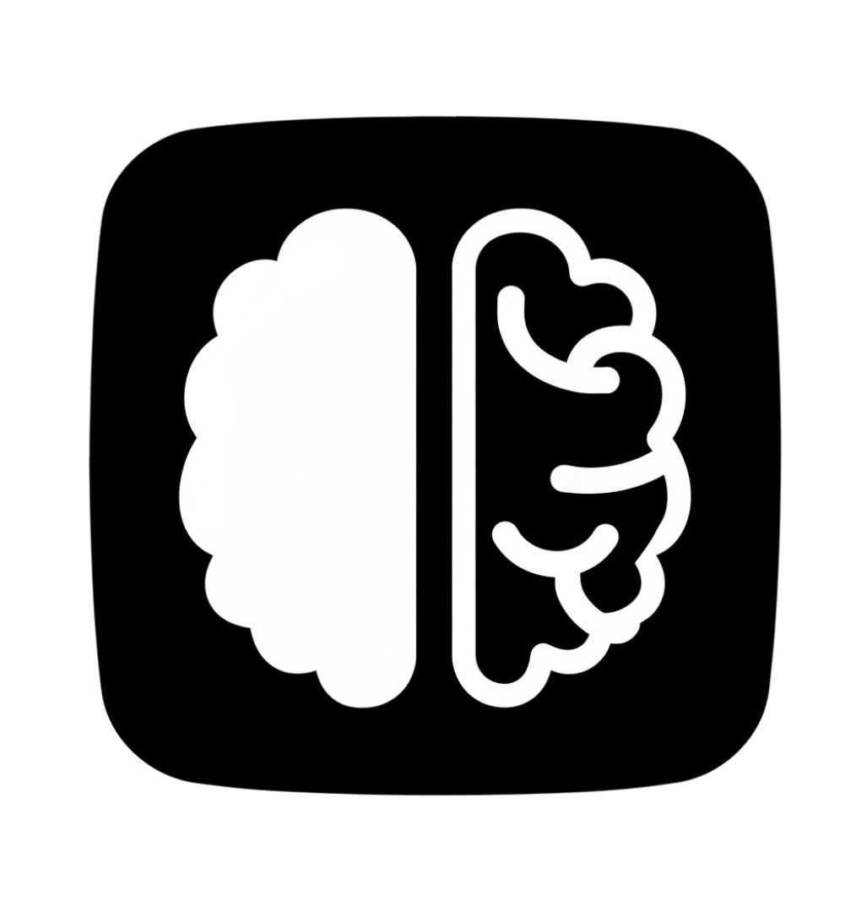
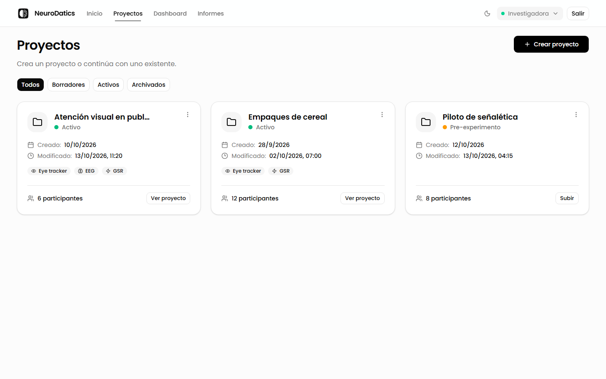
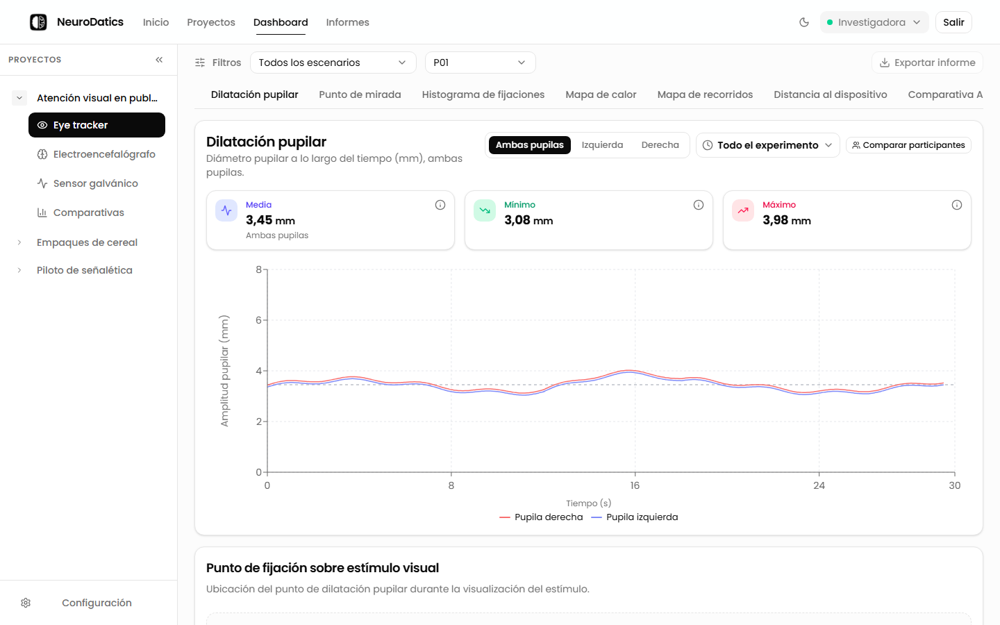
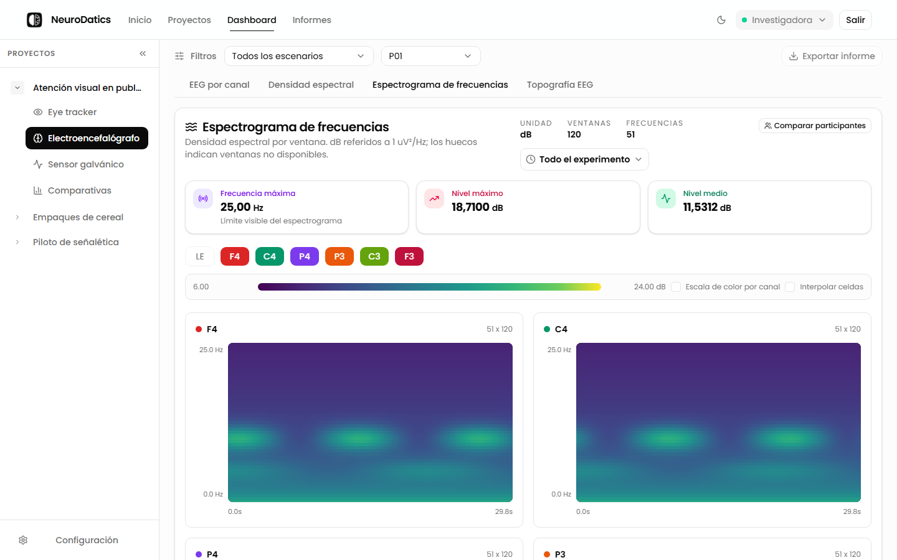
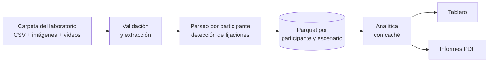

<div align="center">



# NeuroDatics

**Análisis de bioseñales para estudios de neuromarketing**

Convierte la sesión cruda de un laboratorio —eye tracker, EEG y sensor galvánico— en analítica consultable:
fijaciones, mapas de calor, áreas de interés, espectros de EEG e informes en PDF.


[Funciones](#qué-puede-hacer) · [Ediciones](#dos-ediciones) · [Manuales](#manuales) ·
[Inicio rápido](#inicio-rápido) · [Documentación](#documentación) · [Desarrollo](#desarrollo)



</div>

## Qué es

En un estudio de neuromarketing, el software de adquisición exporta una carpeta por sesión: un CSV con las
grabaciones sincronizadas de todos los participantes y las imágenes y vídeos que se les mostraron. NeuroDatics
recibe esa carpeta, la valida, **recalcula las fijaciones desde la mirada cruda** en lugar de fiarse de las del
fabricante, lleva cada coordenada al sistema del estímulo y guarda el resultado en un formato columnar que se
consulta rápido. Encima de eso ofrece un tablero interactivo y genera informes por dispositivo.

Tres principios guían cada número que muestra: **nada se inventa** (un dato ausente sigue ausente y una
coordenada fuera de rango se rechaza, no se recorta), **la procedencia viaja con el resultado** (cada respuesta
dice qué algoritmo la produjo y con qué parámetros) y **la pantalla y el PDF no pueden discrepar**, porque usan
los mismos servicios.

## Qué puede hacer

| | |
| --- | --- |
| **Proyectos y pre-experimentos** | Registrar un estudio antes de tener datos: participantes, pantalla, cuestionarios de antes y después y notas. La carpeta del experimento se agrega cuando existe. |
| **Ingesta del experimento** | Sube la carpeta del laboratorio desde el navegador; interpreta CSV europeos multi-participante con distintas codificaciones y frecuencias de muestreo, y publica todo en una sola operación. |
| **Eye tracker** | Dilatación pupilar, punto de mirada, histograma de fijaciones, mapa de calor, recorrido de la mirada y distancia al dispositivo, sobre el estímulo real. |
| **Áreas de interés** | AOIs dibujadas sobre cada estímulo, con tiempo hasta la primera fijación, permanencia, revisitas, transiciones y hallazgos clave. |
| **EEG** | Señal por canal, densidad espectral (Welch), espectrograma y topografía, con avisos de calidad explícitos. |
| **Sensor galvánico** | Respuesta galvánica de la piel con sus estadísticas y su línea base. |
| **Comparar participantes** | Varias personas lado a lado, con el mismo instante marcado en todas las gráficas. |
| **Informes** | Un PDF por dispositivo, para un participante o para el grupo, con gráficas y tablas. |

<table>
  <tr>
    <td width="50%"></td>
    <td width="50%"></td>
  </tr>
  <tr>
    <td align="center"><sub>Eye tracker: dilatación pupilar con sus estadísticas</sub></td>
    <td align="center"><sub>EEG: espectrograma de frecuencias por canal</sub></td>
  </tr>
</table>

<sub>Las capturas usan datos sintéticos.</sub>

## Dos ediciones

El mismo código se entrega de dos formas:

| | Edición servidor | NeuroDatics Estudiantes |
| --- | --- | --- |
| **Para quién** | Un laboratorio o grupo que comparte proyectos | Un estudiante en su propio portátil |
| **Cómo se usa** | Navegador contra un servidor con Docker | Un programa de Windows, sin instalación |
| **Cuenta** | Inicio de sesión con Google | Ninguna |
| **Archivos** | Google Drive | Una carpeta en el equipo |
| **Red** | Red local o institucional | Ninguna: todo ocurre en `127.0.0.1` |

## Manuales

Los manuales para quien instala y usa NeuroDatics están en PDF en [manuales/](manuales):

| Manual | Para qué |
| --- | --- |
| [Manual de uso](manuales/NeuroDatics-Manual-de-uso.pdf) | Usar la aplicación paso a paso, en las dos ediciones: proyectos, datos, tablero, pre-experimentos e informes. |
| [Guía de instalación: edición servidor](manuales/NeuroDatics-Guia-de-instalacion-servidor.pdf) | Instalar, iniciar y detener la edición servidor (Docker) en Windows. |
| [Guía de instalación: NeuroDatics Estudiantes](manuales/NeuroDatics-Guia-de-instalacion-estudiantes.pdf) | Descomprimir y abrir la edición de estudiantes en Windows. |
| [Guía de procesamiento](manuales/NeuroDatics-Guia-de-procesamiento.pdf) | Para investigadores: cómo se limpian, calculan y resumen las señales, y qué recalcular si tu objetivo es otro. |

## Inicio rápido

### Edición servidor

Requisitos: Docker Desktop y Git.

```powershell
git clone https://github.com/Proyecto-Software-Biosenales/NeuroDatics-App.git
cd NeuroDatics-App
Copy-Item .env.example .env      # completa POSTGRES_PASSWORD, AUTH_JWT_SECRET y las credenciales de Google
docker compose up -d --build
```

La aplicación queda en **http://localhost:3000** (la API en `/api` y su documentación en `/docs`). El contenedor
del backend aplica las migraciones antes de arrancar. [`.env.example`](.env.example) documenta todas las
opciones, y [deployment/CONFIGURACION-GOOGLE.md](deployment/CONFIGURACION-GOOGLE.md) explica cómo obtener las
credenciales de Google y conectar Drive.

Para instalarla en un equipo sin entorno de desarrollo existe un instalador en español con dos botones,
**INSTALAR** e **INICIAR**: ver la [guía de instalación](manuales/NeuroDatics-Guia-de-instalacion-servidor.pdf) y
[deployment/README.md](deployment/README.md).

<details>
<summary>Comandos de operación</summary>

```powershell
docker compose logs -f                 # registros de todos los servicios
docker compose up -d --build           # reconstruir tras actualizar el código
docker compose down                    # detener sin borrar datos
docker compose down -v                 # borrar base de datos y cachés (destructivo)
```

Si un servicio aparece como `unhealthy`, revisa `docker compose logs --tail=200 backend` antes de borrar nada. El
backend expone `/health` y `/health/ready`. Para una red universitaria o corporativa, ver
[docs/tecnica/despliegue-en-red.md](docs/tecnica/despliegue-en-red.md).

</details>

### NeuroDatics Estudiantes

El estudiante recibe un zip; al extraerlo ve solo `neurodatics-estudiantes.exe` y `LEEME.txt`. Al abrir el
programa, arranca su propia base de datos y abre el navegador. Los proyectos se guardan en
`%LOCALAPPDATA%\NeuroDatics Estudiantes`, así que borrar la carpeta del programa no los borra. La guía del
estudiante es la [guía de instalación](manuales/NeuroDatics-Guia-de-instalacion-estudiantes.pdf) (y, dentro del
paquete, [student/LEEME.txt](student/LEEME.txt)), y cómo se construye el paquete está en
[student/README.md](student/README.md).

## Cómo funciona



El backend es **FastAPI** con SQLAlchemy asíncrono, pandas, NumPy, SciPy y PyArrow; los informes se componen con
**Typst**. El frontend es **Next.js** con React, TypeScript, Tailwind, shadcn/Radix y Recharts. Los datos
relacionales viven en **PostgreSQL 16** y los bytes (estímulos y Parquet) en Google Drive o en disco. El recorrido
completo está en [docs/tecnica/arquitectura.md](docs/tecnica/arquitectura.md).

## Documentación

| Si quieres… | Lee |
| --- | --- |
| Entender la aplicación de un vistazo | [Arquitectura](docs/tecnica/arquitectura.md) |
| Saber qué cambió | [CHANGELOG](docs/CHANGELOG.md) |
| Usar la aplicación paso a paso | [Manual de uso (PDF)](manuales/NeuroDatics-Manual-de-uso.pdf) |
| Justificar los resultados en un estudio | [Guía de procesamiento (PDF)](manuales/NeuroDatics-Guia-de-procesamiento.pdf) |
| Preparar un estudio sin datos todavía | [Pre-experimento](docs/usuario/pre-experimento.md) |
| Interpretar la comparación entre participantes | [Comparar participantes](docs/usuario/comparar-participantes.md) |
| Conocer los algoritmos | [Fijaciones](docs/tecnica/deteccion-de-fijaciones.md) · [Coordenadas](docs/tecnica/coordenadas-pantalla-estimulo.md) · [EEG](docs/tecnica/eeg/metodos.md) · [Informes](docs/tecnica/informes.md) |
| Ver el índice completo | [docs/README.md](docs/README.md) |

## Estructura del repositorio

```text
backend/      API FastAPI: ingesta, analítica, informes, migraciones y la edición local
frontend/     interfaz Next.js, común a las dos ediciones
student/      construcción y comprobaciones de NeuroDatics Estudiantes, y su guía
deployment/   instalador de la edición servidor para Windows
docs/         documentación por público: usuario, técnica y desarrollo
manuales/     manual de uso y guías de instalación y de procesamiento, en PDF
verify.ps1    la puerta de verificación del repositorio
```

## Desarrollo

```powershell
cd frontend; npm ci; npx playwright install chromium; cd ..
.\verify.ps1
```

`verify.ps1` es la única puerta de verificación: pruebas del backend con resultados de referencia protegidos,
Ruff, Vulture, deptry, contratos de importación, arranque de la aplicación, TypeScript, pruebas del frontend en
Node y en Chromium real, y ESLint. Cómo preparar el entorno, las reglas de las dos ediciones y el detalle de cada
prueba están en [CONTRIBUTING.md](CONTRIBUTING.md).

## Autores

Desarrollado por **Jacobo D'león** y **María Alejandra Muñoz**.

## Licencia

© 2026 Jacobo D'león y María Alejandra Muñoz. Todos los derechos reservados; ver [LICENSE](LICENSE). El
software de terceros incluido conserva sus propias licencias.
