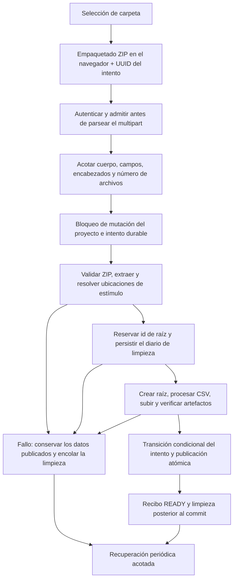

# Pipeline de subida de experimentos

Documento vivo del flujo de ingesta: qué hace una subida, en qué orden, qué garantiza y qué no.
Integra el endurecimiento del pipeline aplicado el 12 de septiembre de 2026, que antes vivía en un
documento aparte. Describe el comportamiento del código que está en la rama, no la configuración de
un despliegue en particular.

Para el contrato de coordenadas que se resuelve durante la subida, ver
[SCREEN_TO_STIMULUS_TRANSFORM.md](SCREEN_TO_STIMULUS_TRANSFORM.md); para el detector de fijaciones
que corre dentro del paso de CSV, [FIXATION_V2.md](FIXATION_V2.md). El historial de los cambios de
producto está en [CHANGELOG.md](CHANGELOG.md), y las notas de las campañas que lo precedieron quedaron
en el historial de Git bajo el tag de archivo (`git show docs-archive-pre-release:<ruta>`).

## 1. Qué hace una subida

Una subida de experimento toma una carpeta del computador del usuario, la empaqueta en un solo ZIP en
el navegador, lo envía a la API, deriva los datos analíticos de su CSV, guarda los medios
seleccionados y los Parquet derivados en el almacenamiento de objetos, y publica sus referencias en la
base de datos. La solicitud HTTP permanece abierta hasta que ese trabajo y su limpieza terminan.

Hay **una sola implementación de ingesta**, usada tanto por la creación como por la edición de un
proyecto. No hay cola ni worker de subidas: el modelo histórico `processing_jobs` y su repositorio
siguen existiendo, pero el endpoint de subida no crea ni ejecuta esos trabajos. Redis sirve a la caché
de analítica; no hace durable la subida.

El almacenamiento de objetos lo elige
`modules/integrations/storage_provider.py`: Google Drive en la edición de servidor, una carpeta en
disco bajo el directorio de datos en NeuroDatics Estudiantes (`APP_MODE=local`). Las dos
implementaciones tienen los mismos métodos y las mismas formas de retorno, así que todo lo que sigue
describe las dos ediciones; donde el texto diga «Drive», en local es la carpeta local.

Tres clases de estado hay que mantener separadas al leer el código:

| Estado | Dónde vive | Significado |
| --- | --- | --- |
| Ciclo de vida del proyecto: `draft`, `active`, `archived` | `projects.status` | Si la configuración del proyecto se finalizó. |
| Ingesta: `PENDING`, `PROCESSING`, `READY`, `FAILED` | `projects.ingestion_status` | El resultado grueso de la ingesta. |
| Intento de subida: `processing`, `uploading`, `canceling`, `completed`, `failed` | `upload_attempts` | Estado durable de un intento concreto, con su UUID, su error y su raíz pendiente de limpieza. |
| Fase de transferencia y progreso | Estado del navegador y un registro en memoria | Progreso temporal de la solicitud. |

`ingestion_generation` es un cuarto concepto distinto: un entero que identifica los datos publicados
vigentes, para la frescura de las cachés. Avanza en la transacción que publica un reemplazo exitoso.
Por tanto `READY` significa que la publicación de datos funcionó; no significa que el asistente de
creación haya terminado de guardar participantes, sensores, anotaciones y la activación del proyecto.

## 2. Contrato de corrección

Una subida prepara una **generación nueva en su propia raíz**. Los archivos existentes siguen siendo
los autoritativos hasta que una sola transacción de base de datos publica archivos, escenarios,
participantes y sensores detectados, la generación de ingesta y un recibo durable de finalización.

- Un fallo **antes** de la publicación conserva la generación anterior. Si el proyecto ya estaba
  `READY`, sigue `READY` con sus datos anteriores (`IngestionLifecycle.recover`); solo un proyecto que
  nunca publicó queda `FAILED`.
- Un fallo **después** de la publicación nunca borra la raíz de esa generación.
- Una transición condicional del intento cerca la publicación frente a la recuperación, por si el
  worker pierde su conexión de bloqueo.
- Los identificadores de la raíz remota se reservan y se persisten en el diario de limpieza **antes**
  de crearla en el almacenamiento, de modo que un corte no deja una carpeta sin dueño conocido.



## 3. El recorrido, etapa por etapa

### 3.1 Descubrimiento de la carpeta y decisiones del usuario

La interfaz de creación acepta un selector de directorio o arrastrar y soltar una carpeta.
Reconstruye las rutas de los archivos soltados, descarta archivos ocultos y *resource forks*, compara
el tamaño agregado seleccionado contra `500 * 1024 * 1024` y llama al analizador de estructura
compartido. Son MiB binarios aunque la interfaz y los ajustes digan «MB».

El analizador reconoce componentes de ruta completos llamados `Images`, `Videos` y `Acquisition`, sin
distinguir mayúsculas. Inventaría los CSV candidatos fuera de `Acquisition`, los directorios de
medios y los nombres de los directorios de grabación. Cuando hay varios candidatos pide elegir; cuando
falta un directorio de medios pide confirmarlo. Un nombre como `Sujet_P01_Scenario_Ad A_Rec1` puede
aportar participante y escenario por defecto.

Las decisiones del cliente mejoran la experiencia, pero el backend repite toda la validación:
`folderStructure.ts` refleja deliberadamente las reglas de `ZipValidationService`, y la autoridad es
siempre el backend.

Fuente: `frontend/features/projects/create-project/CreateProjectStep1.tsx`,
`folderStructure.ts`, `frontend/features/projects/edit-project/EditProjectDialog.tsx`.

### 3.2 Empaquetado y borrador

El navegador carga JSZip con `await import()`, añade los archivos en rutas relativas al archivo y
llama a `generateAsync` con `compression: "STORE"`. STORE evita el trabajo de compresión, así que el
ZIP pesa aproximadamente lo que la carpeta, pero el archivo completo se arma en memoria antes de
transferirlo. La verificación del tamaño agregado no cuenta los encabezados del ZIP, así que una
carpeta exactamente en el límite puede producir un ZIP por encima del límite del servidor.

La creación obtiene un id de proyecto con `POST /api/projects/` en `draft`/`PENDING`; un borrador
reanudado se actualiza. Un nombre repetido devuelve 409. El asistente sube contra ese id.

El ciclo de vida del intento en el navegador está en un solo lugar
(`useZipUploadAttempt.ts`), igual que el empaquetado y las comprobaciones de duplicados
(`packageExperimentFolder.ts`) y el mapeo de los metadatos detectados (`uploadMetadata.ts`). Un error
de red, una cancelación, un borrador reanudado o una lectura de detalle fallida **no** borran el
proyecto: el recibo de una subida exitosa se conserva en el estado de la interfaz, así que un `GET` de
detalle que falle se puede reintentar sin volver a subir.

No hay salida de ZIP en streaming, transferencia reanudable desde el navegador ni contrato de
cancelación del empaquetado. La amplificación exacta de memoria del navegador no está medida.

### 3.3 Transferencia y proxy

`apiUploadFormWithProgress` usa `XMLHttpRequest`, porque `fetch` todavía no tiene evento de progreso
de subida. Adjunta el token, comprueba su vencimiento, trata el 401 como fallo de autenticación, usa
un tiempo límite de 30 minutos y acepta un `AbortSignal`. El navegador mide solo la transferencia
navegador→servidor; cuando termina, la interfaz pasa a «procesando» y consulta el endpoint de progreso.

El proxy de Next.js reenvía `/api` por el mismo origen con `proxyClientMaxBodySize: "550mb"` y
`proxyTimeout: 30 * 60_000`. El backend expone el puerto 8000 solo en la red interna de Docker; el
servicio publicado es el frontend. Eso no es un tiempo límite del trabajo de ingesta, ni una cuota de
disco, ni una garantía de que un proxy corporativo aguante media hora.

En la edición de estudiantes no hay proxy: el backend sirve la exportación estática del frontend
desde su propio origen (`local/static_frontend.py`).

Fuente: `frontend/lib/api/apiFetch.ts`, `frontend/features/projects/api/projectsApi.ts`,
`frontend/next.config.mjs`, `docker-compose.yml`.

### 3.4 Contrato de la API y frontera de recepción

`POST /api/projects/{project_id}/files/experiment-zip` recibe `multipart/form-data`:

| Campo | Propósito |
| --- | --- |
| `file` | ZIP, obligatorio. |
| `upload_id` | UUID del intento, compartido por subida, progreso y cancelación. |
| `selected_csv_path` | Elección explícita del CSV, relativa al archivo. |
| `selected_images_folder`, `selected_videos_folder` | Elección explícita de los directorios de medios. |
| `selected_acquisition_folder` | Directorio `Acquisition` usado para los valores por defecto. |
| `allow_missing_images`, `allow_missing_videos` | Confirmación explícita de la ausencia de medios; por defecto `false`. |
| `screen_width_px`, `screen_height_px`, `screen_width_mm`, `screen_height_mm`, `viewing_distance_mm` | Calibración física de la pantalla, opcional. |
| `stimulus_placements_json` | Sobres de ubicación que atan cada medio seleccionado a las coordenadas de la pantalla de adquisición. |

La ruta se instala con una clase de ruta propia (`upload_route.py`) que se interpone **antes** de que
FastAPI parsee el multipart. En ese orden:

1. Autentica y resuelve el usuario.
2. Rechaza un `Content-Length` inválido, y con 413 uno declarado por encima del límite (el tope del
   ZIP más 2 MiB de margen para el resto del formulario).
3. Rechaza con 415 cualquier `Content-Type` que no sea `multipart/form-data`.
4. Toma el turno de admisión (`upload_admission_control.slot`).
5. Parsea con un lector acotado: el flujo se corta en cuanto los bytes recibidos pasan el límite
   (413), un campo de formulario no puede pasar de 1 MiB, los encabezados de una parte no pasan de
   16 KiB, y se aceptan como máximo un archivo y 20 campos. Los campos duplicados dan 400.
6. Entrega el formulario ya acotado a FastAPI, sin copiarlo otra vez.

El dueño del proyecto y el bloqueo de mutación se comprueban después, sobre un formulario que ya está
acotado. Con la versión fijada de Starlette, los archivos temporales se cierran también en los
caminos de desconexión y cancelación, no solo ante un error del parser.

### 3.5 Admisión, propiedad y almacenamiento

La admisión es local al proceso, con un cerrojo de hilos. Por defecto permite una ingesta activa por
usuario, cuatro globales y al menos cinco segundos entre arranques. El rechazo devuelve 429 con
`Retry-After`. Es una puerta de concurrencia y de tasa: no es una cola, ni una reserva de
almacenamiento, ni una cuota durable, y el límite global es **por proceso de API**.

El caso de uso carga el proyecto por `(project_id, owner_id)`, incluyendo archivos, participantes,
sensores, escenarios y anotaciones. Después deja usable el almacén de objetos. En servidor eso
significa configurar el cliente de Drive desde el único registro `system_integrations` de
`google_drive`; si no hay conexión guardada, la respuesta es 503 antes de cualquier escritura. En local
no hay credenciales que configurar y siempre está disponible.

El transporte a Drive respeta el requisito de la SDK de Google: cada hilo construye y reutiliza su
propio `httplib2.Http` (`_thread_state = threading.local()`), y la rotación de credenciales invalida
los servicios sin compartir un transporte entre hilos. `build_isolated_drive_client` además arma un
cliente nuevo para una sola solicitud, de modo que una lectura no toca el singleton compartido.

### 3.6 Validación del archivo y resolución del manifiesto

El validador comprueba el sufijo del nombre, los tipos MIME declarados aceptados
(`application/zip` y `application/x-zip-compressed`), el tamaño en disco y los límites del directorio
central: expansión declarada, expansión por entrada, número de entradas y razón de compresión. `enforce_archive_limits` lee solo el directorio central y no
descomprime nada, pero ese directorio lo controla quien envía el archivo, así que los tamaños
declarados nunca son el único límite de extracción.

Después recorre la estructura y resuelve las selecciones pedidas. No tener un CSV usable es un error
de validación. Varios CSV o varias carpetas de medios con el mismo nombre exigen una elección. La
ausencia de `Images`/`Videos` exige su confirmación. Un árbol `Acquisition` aporta valores por
defecto y no se trata como otra fuente de datos; seleccionar un árbol filtra las grabaciones de los
demás.

Una estructura sin resolver devuelve 409 con `detail.error = "structure_clarification_required"`, las
preguntas, el nombre del campo que responde cada una y las opciones detectadas. El endpoint no guarda
una sesión de subida en curso: responder una pregunta implica reenviar el archivo completo. Adivinar
analizaría el archivo equivocado en silencio.

Los nombres originales de los miembros se validan antes de normalizarlos. Los miembros duplicados, los
alias de ruta, el recorrido de directorios (`..`), los miembros cifrados o no soportados, los desajustes
con el manifiesto y una diferencia exacta en el tamaño de extracción fallan en cerrado.

El manifiesto seleccionado clasifica las extensiones de imagen como `scenario_image`, las de vídeo como
`scenario_video`, el CSV como `raw_csv`, el PDF como `report_pdf` y lo demás como `other_asset`. Un
medio fuera de un ancestro con nombre de medios baja a recurso ordinario. Los CSV y árboles de medios
no seleccionados y el contenido de `Acquisition` quedan excluidos de los artefactos extraídos.

**Excluir no es borrar del ZIP guardado.** Con la retención del ZIP original activada, el archivo
exacto recibido también se sube, y lo excluido sigue dentro de él. Por eso la retención está apagada
por defecto.

La clasificación por extensión y MIME no prueba que un medio sea decodificable ni seguro: no hay
inspección del contenido.

Fuente: `modules/projects/application/services/zip_validation_service.py`.

### 3.7 Extracción y ubicación del estímulo

La extracción crea `neurodatics-ingestion-*` y escribe solo las entradas del manifiesto bajo un
directorio `extracted`. Rechaza rutas relativas con `..`, rutas absolutas y prefijos de unidad. Lee
cada miembro hasta EOF, lo que hace que `zipfile` verifique su CRC, y **vuelve a contar los bytes que
realmente salen** contra el presupuesto de la entrada y el total. Nunca llama a un `extractall` sin
restricciones.

Con los medios seleccionados aún en disco local, el pipeline resuelve la ubicación del estímulo. Un
sobre debe identificar sin ambigüedad un medio seleccionado, concordar con la calibración de pantalla
y satisfacer el contrato estático de ubicación. Las rutas desconocidas, la calibración incompatible, la
identidad ambigua y la geometría variable en el tiempo se rechazan con errores 422 estructurados. La
instantánea de la ubicación y la calibración física viajan a los metadatos del archivo y a la salida
analítica.

El sondeo de imagen y vídeo registra ancho y alto intrínsecos y, cuando se puede, cuadros por segundo
y duración. Un medio ilegible puede quedar con dimensiones desconocidas en vez de hacer fallar la
ingesta; el renderizado posterior usa entonces dimensiones de referencia.

La validación, la extracción y parte del sondeo corren de forma sincrónica dentro del caso de uso
asíncrono, así que pueden ocupar el bucle de eventos de la API. Los directorios temporales se borran al
salir del ámbito; una terminación abrupta del proceso puede dejarlos, y la recuperación durable cubre
la publicación y la limpieza del almacén, no un recolector completo del sistema de archivos.

Fuente: `zip_extraction_service.py`, `stimulus_probe_service.py`,
[SCREEN_TO_STIMULUS_TRANSFORM.md](SCREEN_TO_STIMULUS_TRANSFORM.md).

### 3.8 Procesamiento del CSV y artefactos analíticos

Después de validar, extraer y resolver las ubicaciones, el caso de uso compromete `PROCESSING`,
comprueba la cancelación y crea una raíz nueva. Procesa cada CSV crudo seleccionado con
`asyncio.to_thread(CsvProcessingService.process, ...)`. La resolución normal selecciona un CSV; el
bucle y la respuesta conservan la contabilidad en plural.

El parser hace, en orden:

1. Lee los bytes del CSV a memoria, decodifica las codificaciones UTF soportadas o Latin-1 y separa el
   texto en líneas. No es un parser en streaming.
2. Identifica bloques de grabación por sus marcadores y encabezados de tiempo reconocidos; extrae
   códigos de participante y etiquetas de grabación.
3. Elige el delimitador (punto y coma, tabulador o coma), canonicaliza los alias de columna conocidos,
   conserva las columnas extra, interpreta los números localizados y valida los canales numéricos
   conocidos y los valores de tiempo.
4. Lee unidades y frecuencias declaradas por canal, normaliza las unidades soportadas, estima la
   frecuencia observada de la rejilla temporal y registra las discrepancias en vez de tratar la
   frecuencia del archivo y la del eye tracker como intercambiables.
5. Separa las fijaciones del fabricante de la mirada cruda. Donde hay mirada cruda emparejada ejecuta
   fixation-v2: detección angular I-VT adaptativa cuando hay calibración física, y respaldo en
   coordenadas normalizadas cuando no. Registra remuestreo, versión del detector, advertencias,
   espacio de coordenadas y procedencia de la transformación del estímulo.
6. Escribe un Parquet completo del bloque del participante y sus particiones por escenario, en
   `processed/userN/userN.parquet` y `processed/userN/escenarios/<escenario-limpio>.parquet`.

Los pasos 2 a 6 corren una vez por bloque de participante y los bloques no comparten nada. Desde
10 000 líneas, `process(max_workers=N)` reparte los bloques entre hasta N procesos arrancados con
`spawn` y reúne sus resultados en el orden del archivo, así que los Parquet, los metadatos y el primer
error coinciden con una ejecución de uno en uno. `INGESTION_BLOCK_WORKERS=0`, el valor por defecto,
dimensiona el grupo a la máquina (`shared/machine_resources.py`): la mitad de las CPU utilizables,
hasta donde alcance la memoria. Cada ingesta que pueda correr a la vez (una en la edición de
estudiantes, `UPLOAD_MAX_CONCURRENT_GLOBAL` en el servidor) recibe una parte igual del límite de
memoria, que es el límite del contenedor o la mitad de la RAM si no hay. Cada ingesta reserva 1 GiB de
su parte más 256 MiB por worker. Cualquier valor positivo fuerza ese número, y 1 mantiene todos los
bloques en el proceso de la API; el valor por defecto del servidor (2 GiB para cuatro ingestas) se
queda en 1 worker. Si el grupo no arranca o pierde un worker, los bloques corren en el proceso. El
punto de entrada congelado llama primero a `multiprocessing.freeze_support()`, así que un worker nunca
arranca una segunda aplicación.

Los detalles del detector están en [FIXATION_V2.md](FIXATION_V2.md). La responsabilidad del pipeline de
subida es conservar las unidades, la identidad y la procedencia necesarias para interpretar esos
resultados; la detección científica no se cambia como efecto secundario de un refactor de subida.

El resultado del procesamiento incluye sensores detectados, códigos de participante e índices de
bloque, rutas generadas, metadatos por bloque, instantáneas de ubicación y advertencias. Antes de
subir, el caso de uso verifica que los Parquet generados tengan código de participante y que dos
bloques no reclamen la misma identidad. La analítica resuelve participantes por código, nunca por el
orden de las filas de la base de datos.

Las etiquetas de escenario con aspecto numérico, como `001` y `1`, se mantienen como cadenas y no
colapsan en una misma identidad. Los nombres de archivo portables que colisionan reciben un sufijo
determinista de hash; el nombre remoto usa el nombre base del artefacto generado, la deduplicación usa
la etiqueta original del escenario, y una salida en conflicto se rechaza.

Un CSV seleccionado que no se puede procesar incrementa la cuenta de fallos; si ninguno se procesa,
`CsvIngestionError` impide la publicación y el avance de la generación.

El caso de uso de subida **no persiste filas de participante ni de sensor**: devuelve los valores
detectados y la publicación los escribe junto con los archivos. Los escenarios se crean a partir de
los medios subidos, así que un escenario que existe en el CSV pero no tiene medio es un asunto
distinto, de completitud.

Fuente: `csv_processing_service.py`, `fixation_detection_service.py`.

### 3.9 Subida al almacén y progreso

Cada ingesta crea una raíz nueva con el nombre del proyecto, el prefijo del id y una marca de tiempo
UTC, opcionalmente bajo `GDRIVE_FOLDER_ID`. Esa raíz es independiente de la publicada antes, y la
solicitud guarda la lista de objetos creados para compensar.

Solo se guarda lo que la aplicación lee después: las imágenes y vídeos de escenario seleccionados, los
Parquet completos por participante y los Parquet por escenario. Las carpetas se crean nivel por nivel
bajo la raíz nueva, sin búsquedas, y los archivos suben `GDRIVE_UPLOAD_CONCURRENCY` a la vez (4 por
defecto) en hilos de trabajo. Solo el bucle de eventos toca la base de datos para progreso y
cancelación. Ante un fallo, las subidas en vuelo se esperan antes de borrar la raíz. Las filas
`ProjectFile` se construyen después, en el orden determinista original.

El ZIP armado por el navegador no se guarda por defecto (`INGESTION_SAVE_ORIGINAL_ZIP=false`), porque
duplicaba todos los archivos subidos; se guarda el nombre de la carpeta elegida en
`projects.source_folder_name`. Los CSV crudos se cuentan pero no se suben, así que con la retención
apagada sus bytes fuente no quedan en el almacén y reprocesar exige volver a subir la carpeta. Los
hijos referencian la fila del ZIP guardado por `source_zip_id`, o `null` cuando la retención está
apagada; antes de borrar un ZIP padre, esa referencia se desprende de los hijos históricos, de modo
que el reemplazo y el borrado solo del ZIP no violan la clave ajena, y un rollback restaura ambas
referencias.

La integridad de los bytes se verifica: las creaciones usan identificadores reservados y reconcilian
una respuesta perdida, los reintentos reanudables consultan el desplazamiento reconocido, el tamaño
subido y el SHA-256 (o el MD5 que devuelve Drive, como respaldo) deben coincidir con el origen, y los
flujos de medios siempre se cierran. `upload_file` calcula el SHA-256 con una lectura secuencial
aparte y luego usa `MediaFileUpload` con trozos de 8 MiB y `resumable=True`. El protocolo reanudable
se usa para esa transferencia, pero NeuroDatics no persiste su sesión ni su desplazamiento, así que un
reinicio de la aplicación no reanuda la subida.

El registro de progreso arranca después de procesar el CSV, cuando ya se conocen los tamaños de
salida. Los bytes avanzan al terminar **un archivo completo**, no cada trozo, y se quedan en 99 %
hasta que la publicación en base de datos funciona. Una subida grande puede, por tanto, no mover la
cifra durante un buen rato. Su campo se llama `speed_mbps`, pero el cálculo divide bytes entre
`1024 * 1024`: el valor es MiB/s, no megabits por segundo.

### 3.10 Publicación en la base de datos y reemplazo

Terminadas las subidas y cerrado el ámbito de extracción, el caso de uso comprueba la cancelación,
hace la transición condicional del intento y ejecuta la transacción de publicación:

1. Borrado lógico de las filas activas de `project_files`.
2. Desprender las referencias `source_zip_id` de los hijos históricos y borrar físicamente las filas
   `experiment_zip`.
3. Borrar los AOI y escenarios existentes.
4. Insertar las filas de archivo nuevas, los escenarios derivados de los medios y sus ubicaciones.
5. Publicar participantes y sensores detectados junto con los archivos. Un código de participante que
   coincide conserva su demografía.
6. Poner `READY`, limpiar el error de ingesta, actualizar la raíz y la marca de tiempo.
7. Incrementar `ingestion_generation` de forma atómica y hacer commit.

Los métodos de repositorio de esta sección hacen `flush`, no `commit` por separado, así que la
generación y las referencias publicadas se hacen visibles juntas. Una publicación que falla deshace
toda la transacción; el `PROCESSING` anterior es un commit aparte.

Las anotaciones se copian solo cuando el medio es el mismo: `preserve_unchanged_stimulus_annotations`
exige que la ruta fuente del estímulo, sus bytes y su geometría intrínseca coincidan. Un medio que
cambió recibe anotaciones nuevas en lugar de heredar AOI que ya no corresponden.

En éxito, la raíz anterior se borra **después** del commit, a través del diario de limpieza, de modo
que un borrado que falla deja un registro durable para un barrido posterior en vez de perderse en un
log. Un fallo de la limpieza o de la poda de cachés no deshace la publicación.

El borrado del proyecto y el del ZIP comprometen primero su cambio en la base de datos y su registro
de limpieza, y solo después tocan el almacén; los registros de limpieza sobreviven al borrado del
proyecto. Si un commit de publicación queda en duda, los datos del almacén se conservan hasta poder
leer el recibo durable.

Fuente: `publish_ingestion.py`, `repository_impl.py`, `drive_cleanup.py`.

### 3.11 Respuesta, cierre del asistente y lecturas

La respuesta exitosa contiene los identificadores del proyecto y la raíz, `READY`, la información de
retención del ZIP, los archivos subidos, contadores, metadatos y advertencias del procesamiento del
CSV, sensores y participantes detectados, la estructura seleccionada, los valores por defecto de
`Acquisition`, las entradas excluidas y las ubicaciones de estímulo. `files_uploaded` cuenta los
artefactos subidos que no son el ZIP; `csv` cuenta las entradas CSV de origen aunque no se guarden por
separado. No son un manifiesto completo de bytes ni de objetos.

El asistente de creación usa ese resumen y un detalle refrescado del proyecto para poblar los pasos
siguientes; el navegador ya no repite por su cuenta la publicación de metadatos que el servidor hace.
`POST /{project_id}/finalize` comprueba nombre, archivos activos o ingesta `READY`, y al menos un
sensor; no establece la completitud participante↔Parquet.

La analítica lee las referencias Parquet activas de un participante y resuelve la generación del
proyecto para la identidad de la caché. La caché Parquet en disco y los resultados en Redis usan
claves con la generación, así que una poda fallida no hace que una generación nueva devuelva
resultados viejos.

Las rutas autenticadas de imagen y previsualización resuelven un archivo activo del proyecto del
dueño. Las imágenes usan caché en disco y en memoria, encabezados de caché privada y ETags; la
previsualización de vídeo usa archivos de vídeo y de cuadro en caché y ffmpeg, invocado con una lista
de argumentos y tiempos límite acotados, nunca como cadena de shell. Son cachés derivadas de lectura,
no almacenamiento fuente durable, y un conserje acotado las recupera
(`media_cache_janitor.py`): el barrido tiene topes de tamaño, de edad y de número de borrados por
pasada, para que nunca pueda frenar el camino de una solicitud. Es limpieza acotada, no una reserva
estricta que impida todo exceso transitorio.

## 4. Cancelación y semántica de fallos

`POST /{project_id}/files/experiment-zip/cancel` comprueba la propiedad, marca el intento y vuelve de
inmediato. Reconoce una petición de cancelar, no su cumplimiento. Las comprobaciones son cooperativas y
corren entre fases y entre archivos: no interrumpen el hilo del CSV ni una llamada `execute` del
transporte en curso. Abortar el XHR por sí solo no es una orden durable de cancelación.

Cada solicitud lleva un UUID opcional compartido por subida, progreso y cancelación. Una cancelación
que llega antes del procesamiento sobrevive a la transición de procesamiento a subida. Un reintento
exige un UUID nuevo: reusar uno ya arrancado devuelve 409, y consultar el progreso de ese UUID devuelve
su resultado. El UUID es un recibo de resultado, no una clave de repetición automática. En el
navegador, la consulta serial compartida aborta las lecturas en vuelo y limpia sus temporizadores en
toda salida, así que una respuesta rancia no puede revivir un intento viejo ni dejar una consulta de
fondo encendida.

Una cancelación y una subida comprometida con éxito son resultados distintos. Cuando el resultado HTTP
es incierto, el cliente debe consultar el recibo.

| Punto de fallo | Resultado y efecto durable |
| --- | --- |
| Autenticación ausente o vencida | Error de autenticación antes de parsear el multipart. |
| `Content-Length` inválido / tipo de contenido equivocado | 400 / 415 antes de parsear. |
| Cuerpo declarado o recibido por encima del límite | 413; el flujo se corta en cuanto se pasa. |
| Campo, encabezado o campo duplicado fuera de límites | 413 o 400 durante el parseo acotado. |
| Admisión agotada | 429 con `Retry-After`; no hay ingesta. |
| Proyecto inexistente o de otro dueño | 404; no hay ingesta. |
| Otra mutación del proyecto en curso | 409 del bloqueo de mutación. |
| Sin conexión de almacenamiento (servidor) | 503 antes de validar y de escribir. |
| ZIP inválido o que necesita aclaración | 400 o 409 estructurado; los datos publicados y su estado de ingesta se conservan. |
| Fallo de extracción o de CRC | 400; los datos publicados y su estado se conservan. |
| Fallo del contrato de ubicación | 422 estructurado; sin publicación. |
| Todos los CSV seleccionados fallan | 500; se compensan los objetos nuevos y la generación anterior queda intacta. |
| Cancelación observada | 409; se compensa, y el intento queda registrado como cancelado. |
| Fallo del almacén o de la base antes de publicar | Se compensa; un proyecto que ya estaba `READY` lo sigue estando con su generación anterior. |
| Fallo de limpieza de la raíz o de la caché después de publicar | Queda en el diario de limpieza para el barrido siguiente; `READY` y la generación nueva permanecen. |
| Tiempo límite del navegador, respuesta perdida, muerte del servidor | El recibo durable del intento dice qué pasó; la recuperación periódica cierra lo que quedó abierto. |

El mensaje que llega al cliente es el del error de dominio para los casos esperados (validación,
aclaración, extracción, ubicación, CSV, identidad de participante, cancelación) y un texto genérico
para cualquier otro, de modo que una excepción inesperada no expone su texto crudo.

El bloqueo de mutación por proyecto (`pg_try_advisory_xact_lock` en una transacción propia) excluye
entre sí las escrituras de subida, borrado, finalización, metadatos, participantes, escenarios y AOI.
Vive en su propia conexión, así que un commit del repositorio no lo libera a medio camino, funciona a
través de un proxy que agrupa transacciones y se libera si el worker se desconecta. La salud del
bloqueo se comprueba en los puntos de control de la subida, y la publicación compite además por la
fila del intento.

## 5. Recuperación y operación

La API arranca un bucle de recuperación con 60 segundos entre barridos
(`upload_recovery_loop`, en el ciclo de vida de `main.py`). Cada barrido considera hasta 32 proyectos
con intentos pendientes, hasta 100 intentos pendientes por proyecto y hasta 32 registros de limpieza.
Un proyecto con el bloqueo tomado se omite. Una limpieza que falla actualiza su marca de tiempo, para
que un objeto que falla siempre no monopolice los lotes siguientes. La recuperación necesita la base de
datos y, en servidor, las credenciales configuradas; si falla, los registros durables esperan al
barrido siguiente.

También hay una ejecución única desde el backend, con su `PYTHONPATH=src` y su entorno normales:

```console
python -m neurodatics.modules.projects.application.use_cases.recover_uploads
```

**Despliegue.** La migración **022** crea `upload_attempts` y `drive_cleanup_tasks`; no reescribe datos
de proyecto. El arranque en Docker ya ejecuta `alembic upgrade head`, igual que el lanzador de la
edición de estudiantes. Backend y frontend se despliegan juntos para tener la cancelación con UUID: un
cliente viejo puede omitirlo, pero solo uno actualizado distingue su propio intento de otros intentos
históricos.

La exclusión de mutaciones reserva una conexión y una transacción adicionales por escritura activa de
proyecto. El dimensionamiento de capacidad tiene que incluirlas junto con las sesiones normales de
solicitud. El tiempo de vida de un bloqueo de transacción está documentado en
[Explicit Locking](https://www.postgresql.org/docs/16/explicit-locking.html) de PostgreSQL. El diseño
del transporte sigue el
[requisito de seguridad entre hilos](https://googleapis.github.io/google-api-python-client/docs/thread_safety.html)
de la SDK, y los identificadores reservados y la subida reanudable siguen la
[guía de subidas](https://developers.google.com/workspace/drive/api/guides/manage-uploads) de Google.

El historial de intentos completados no tiene política de retención automática: conviene vigilar el
crecimiento de la tabla y los fallos de limpieza como parte de la operación normal.

## 6. Configuración y envolvente de recursos

Valores por defecto del repositorio (`backend/src/neurodatics/config/settings.py`, `.env.example`,
`docker-compose.yml`), no valores observados en producción.

| Ajuste o frontera | Por defecto | Qué controla |
| --- | --- | --- |
| Límite agregado en el navegador | 500 MiB | Antes del sobrecosto del ZIP; está en el código. |
| Cuerpo del proxy de Next.js | `550mb` | Manejo del cuerpo en el proxy. |
| Tiempo límite de XHR y del proxy | 30 minutos | Vida de la solicitud, no de un trabajo durable. |
| `PROJECT_ZIP_MAX_SIZE_MB` | 500 | Tamaño del archivo ZIP. |
| `PROJECT_ZIP_MAX_UNCOMPRESSED_MB` | 2000 | Expansión declarada y presupuesto de extracción. |
| `PROJECT_ZIP_MAX_ENTRY_UNCOMPRESSED_MB` | 600 | Presupuesto de expansión por entrada. |
| `PROJECT_ZIP_MAX_ENTRIES` | 20 000 | Guarda sobre el número de entradas. |
| `PROJECT_ZIP_MAX_COMPRESSION_RATIO` | 100 | Guarda sobre la razón de compresión. |
| Campo de formulario / encabezados de parte / archivos / campos | 1 MiB / 16 KiB / 1 / 20 | Límites del parseo acotado. |
| `UPLOAD_MAX_CONCURRENT_PER_USER` / `_GLOBAL` | 1 / 4 | Admisión de ingesta, por proceso. |
| `UPLOAD_MIN_SECONDS_BETWEEN_UPLOADS` | 5 | Separación entre arranques admitidos. |
| `INGESTION_BLOCK_WORKERS` | 0 (automático) | Procesos por CSV: mitad de las CPU utilizables, dentro de la parte de memoria de cada ingesta concurrente. |
| `INGESTION_SAVE_ORIGINAL_ZIP` | `false` | Guardar el archivo exacto recibido. |
| `GDRIVE_UPLOAD_CONCURRENCY` | 4 | Subidas simultáneas por ingesta; acota también las conexiones abiertas. |
| `GDRIVE_HTTP_TIMEOUT_SECONDS` / `GDRIVE_REQUEST_RETRIES` | 300 / 5 | Tiempo límite y reintentos del transporte. |
| `BACKEND_MEM_LIMIT` / `BACKEND_MEM_RESERVATION` | 2 GiB / 512 MiB | Techo y reserva de memoria del contenedor. |
| `PARQUET_CACHE_TTL_HOURS` | 4 | Frescura de la caché Parquet en disco. |
| `ANALYTICS_REDIS_TTL_SECONDS` | 900 | Retención de la caché de resultados. |
| `PARQUET_CACHE_KEEP_PREVIOUS_GENERATIONS` / `_PRUNE_MAX_REMOVALS` | 1 / 32 | Recuperación acotada tras la ingesta. |
| `ANALYTICS_REDIS_STALE_GENERATION_MAX_DELETIONS` | 5000 | Trabajo acotado de invalidación. |
| `MEDIA_CACHE_MAX_BYTES` / `_MAX_AGE_HOURS` / `_PRUNE_MAX_REMOVALS` | 2 GiB / 72 h / 500 | Umbrales del conserje de medios y tope por pasada. |
| Barrido de recuperación | 60 s / 32 proyectos / 100 intentos / 32 limpiezas | Cadencia y tope de la recuperación. |

Para dimensionar capacidad conviene distinguir los bytes recibidos del ZIP, los bytes extraídos, los
Parquet generados, la construcción del ZIP en el navegador, los DataFrames del parser y las cachés
persistentes. Los límites del archivo no son reservas de memoria ni de disco: cuatro ingestas grandes
admitidas a la vez pueden superar la capacidad práctica aunque cada ZIP pase todos los límites. El
techo del contenedor convierte el agotamiento en un contenedor caído; no garantiza un rechazo
elegante. El límite global de cuatro es por proceso de API, igual que el registro de progreso y la
admisión, que son estructuras de módulo: correctos para un proceso de uvicorn, insuficientes en cuanto
se escale horizontalmente.

## 7. Límites conocidos

- La subida sigue usando una solicitud HTTP larga, y el empaquetado en el navegador y el parseo del
  CSV materializan datos considerables.
- Una terminación abrupta del proceso puede dejar directorios temporales de la aplicación. La
  recuperación durable cubre la publicación y la limpieza del almacén, no un recolector completo del
  sistema de archivos.
- La retención del ZIP original guarda el archivo exacto, incluidas las entradas excluidas. Con la
  retención apagada, el CSV crudo no tiene una copia fuente independiente, lo que debilita la
  reproducibilidad.
- La clasificación de medios es por extensión y MIME declarado, con un respaldo permisivo para
  dimensiones desconocidas. No es un análisis de seguridad del contenido.
- Las credenciales de Drive son una integración de todo el sistema, con un token de refresco guardado
  en el servidor y un alcance amplio. El router de autorización está autenticado y el callback usa un
  estado firmado y con vencimiento, pero no hay distinción de rol entre un usuario autenticado
  cualquiera y quien administra la integración. En la edición de estudiantes esto no aplica: no hay
  credenciales ni red.

## 8. Pruebas

La puerta del repositorio es `./verify.ps1`: pruebas del backend y sus snapshots protegidos, Ruff,
Vulture, declaración de dependencias, arranque de la aplicación, contratos de importación, TypeScript,
pruebas unitarias del frontend, regresiones de hooks y componentes en Chromium y ESLint.

Las pruebas específicas del pipeline de subida cubren el rechazo temprano en la recepción, los
miembros exactos del ZIP, la identidad de escenario, la cancelación antes de recibir, la consulta
rancia, la preservación del borrador, el cercado por recibo, un commit de resultado desconocido, el
orden del borrado y el rollback de metadatos y claves ajenas. Algunos ejemplos:

```powershell
Set-Location backend
..\.venv\Scripts\python.exe -m pytest tests/unit/test_upload_pipeline_hardening.py tests/unit/test_zip_validation_service.py tests/unit/test_upload_csv_processing_metadata.py tests/unit/test_upload_cache_generation.py tests/unit/test_upload_stimulus_placement.py tests/unit/test_parquet_participant_identity.py tests/unit/test_csv_processing_service.py tests/unit/test_fixation_v2_pipeline.py tests/unit/test_ingestion_generation_repository.py tests/unit/test_gdrive_client.py -q
```

Qué no prueban: las pruebas de SQL de reemplazo, metadatos y diario ejecutan SQL real contra SQLite con
claves ajenas activadas, no contra el PostgreSQL migrado. Las pruebas de reintento de Drive ejercitan
el `HttpRequest` reanudable real de la SDK con transportes controlados, no una cuenta real. No
sustituyen una prueba de integración con PostgreSQL y Drive en vivo: la concurrencia real de bloqueos
asesores, la aplicación de migraciones en vivo, la recuperación tras matar un proceso y el uso de
recursos en un pico realista siguen sin ejercitarse.

Antes de aceptar un despliegue conviene usar un PostgreSQL y un proyecto de Drive aislados para
verificar una primera subida, un reemplazo con los mismos datos, un reemplazo con participantes o
escenarios distintos, el rechazo de una mutación simultánea, la cancelación durante el CSV y durante
la subida, la búsqueda por UUID de una respuesta perdida, y la terminación del worker antes y después
de publicar. Confirmar que los datos viejos siguen legibles y que las raíces diferidas se recuperan
tras un barrido. No usar experimentos reales como material de prueba destructivo.
