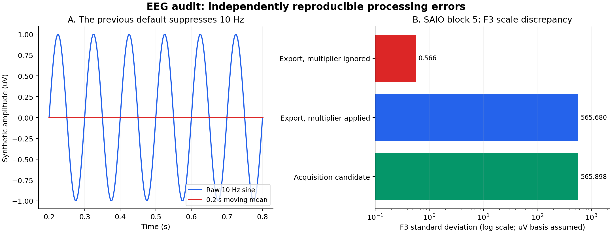

# EEG: validación científica

Revisión del procesamiento de EEG contra grabaciones de referencia reales: ingesta, analítica, correlación,
gráficas y métricas de los informes. Ninguna grabación se subió, se reescribió ni se confirmó en el repositorio.
La evidencia agregada y anónima se reproduce con `backend/scripts/audit_eeg_references.py`
([métodos](metodos.md)). La alternancia entre `kilo` y unidad vacía, su tratamiento y su persistencia están en
[escalas-por-grabacion.md](escalas-por-grabacion.md).

[Huellas anónimas de los archivos fuente y evidencia cuantitativa](evidencia/reference-evidence.json).

## Conclusiones principales

1. **Había un error de escala real.** El bloque 5 de SAIO exporta F3 con un multiplicador de visualización
   `kilo`. Ignorarlo subestima la amplitud 1.000 veces y la potencia 1.000.000 (60 dB). La ingesta aplica ahora
   ese multiplicador y conserva su procedencia. La unidad física sigue siendo una suposición declarada cuando el
   origen la deja en blanco.
2. **Las muestras ausentes se convertían en mediciones plausibles.** La PSD borraba las muestras ausentes antes
   del análisis de Fourier; los espectrogramas borraban filas de todos los canales; la topografía interpolaba
   huecos arbitrariamente largos; la serialización JSON sustituía los valores ausentes por cero. Hoy esas rutas
   conservan los huecos y usan ventanas válidas contiguas sobre el eje de tiempo original.
3. **La vista temporal por defecto suprimía los ritmos del EEG.** Una media móvil de 0,2 s tiene ceros en los
   múltiplos de 5 Hz, incluido 10 Hz. La vista por defecto y la gráfica de comparación usan ahora los valores
   crudos; el suavizado opcional se describe a la vista.
4. **Los límites de calidad de los datos sobreviven a unas matemáticas correctas.** Desplazamientos, transitorios,
   submuestreo no documentado, cuantización gruesa de la exportación y tiempos inciertos no se resuelven cambiando
   una gráfica. Se informan; no se limpian en silencio.

## Inventario de referencia

Los identificadores corresponden al JSON de la auditoría, ordenados por ruta local. Son índices de archivo o de
bloque, no identidades de participantes. Las exportaciones de Realidad son variantes de una misma grabación, no
participantes independientes.

| Entrada | Datos | Resultado |
| --- | --- | --- |
| csv-01 | Referencia solo de mirada, 8 bloques / 28.999 filas | Sin EEG; se conserva como control de ingesta |
| csv-02/03/04 | Tres CSV nativos crudos de DSI | Delimitadores mal formados; el importador ordinario los rechaza |
| csv-05 | Exportación de Realidad a 300 Hz, 27.425 filas | Rejilla uniforme observada de 300,313802806 Hz |
| csv-06 | Exportación de Realidad a 60 Hz, 5.491 filas | Rejilla uniforme observada de 60,119497098 Hz |
| csv-07 | Exportación multisensor de Realidad a frecuencia nativa | Relojes independientes y filas mal formadas; rechazada |
| csv-08 | Multisensor SAIO, 6 bloques / 232.195 filas | Rejilla uniforme observada de 300,332067676 Hz |

La revisión ejercita PSD, espectrograma y topografía sobre **76 combinaciones de bloque y escenario** de EEG,
incluidos segmentos cortos y sin etiqueta; un segmento corto puede, correctamente, no devolver estimación. En los
ocho bloques de EEG utilizables (dos variantes de exportación más seis bloques de SAIO) no hay vectores de siete
canales repetidos enteros ni huecos internos de EEG. El EEG ausente aparece en los bordes de la grabación:

| Entrada/bloque | Filas de EEG ausentes | Detalle |
| --- | ---: | --- |
| Realidad 300 | 604 | 395 al inicio, 209 al final; 26.821 válidas |
| Realidad 60 | 126 | 80 al inicio, 46 al final; 5.365 válidas |
| SAIO 1–6 | 1.222 / 1.345 / 1.204 / 1.376 / 1.216 / 1.259 | Solo en los bordes; 224.573 filas válidas en total |

Esas filas compartidas de la exportación incluyen instantes fuera de la adquisición de EEG; una traza rellenada con
ceros en esos instantes sería falsa. El tratamiento general de huecos sigue siendo necesario para grabaciones
futuras y para apariciones no contiguas del mismo escenario.

## Escala y precisión: F3 de SAIO, bloque 5

La exportación declara `kilo`. Su rango original de F3 es **−0,97 a 9,64**, mediana **−0,21**, desviación
**0,5656804**. Un archivo de adquisición candidato tiene un rango de F3 de **−989,8113 a 9.646,6904**, mediana
**−212,4663**, desviación **565,8978**. La interpretación del factor 1.000 la respaldan tanto los metadatos del
origen como los valores independientes de la adquisición; esos rangos no prueban una alineación temporal exacta
muestra a muestra.

Multiplicar corrige la escala, **no la precisión perdida**: dos decimales en unidades kilo dan saltos de 10
unidades base. El origen tiene 4.632 valores adyacentes idénticos en F3, frente a 115 en el candidato de
adquisición. No interpretes el F3 exportado y corregido como un canal igual de preciso para ritmos pequeños o
comparaciones entre hemisferios; vuelve a exportar ese canal en la escala base con precisión suficiente,
preferiblemente desde el EDF original o un archivo nativo con el formato correcto.

## Artefactos de grabación y límites de tiempo

- El bloque 3 de SAIO contiene cambios de una sola muestra de **750,54** en C4 y **713,23** en C3; P4 del bloque 4
  llega a **556,92**. Son posibles artefactos transitorios. El CSV por sí solo no distingue movimiento, contacto
  del electrodo, saturación, fisiología o una operación previa de exportación.
- Las medianas por canal pueden ser de cientos o miles de microvoltios supuestos; por ejemplo, F3 de Realidad
  **−1.742,06** y C3 del bloque 6 de SAIO **2.397,41**. El desplazamiento de voltaje depende de la referencia.
  Restar la media de un segmento no elimina la deriva arbitraria, los movimientos oculares, la actividad
  muscular ni la interferencia de la red eléctrica.
- La exportación de 60 Hz tiene un Nyquist de **30,05975 Hz**, pero sus metadatos de EEG siguen declarando una
  adquisición de unos 300 Hz y no acompaña ninguna especificación de filtro antialiasing. Gamma (30–45 Hz) no
  está disponible y las bandas bajas dependen del filtrado del exportador. Es preferible la exportación a
  frecuencia nativa.
- El candidato de adquisición de Realidad abarca unos **299,999727 Hz**, mientras que su rejilla exportada es de
  **300,313803 Hz**. No sustituyas un reloj por el otro sin una transformación de sincronización documentada.
- Todos los valores de disparo de SAIO son cero. Las etiquetas de escenario permiten separar condiciones a grandes
  rasgos, pero no establecen por sí solas la latencia del inicio del estímulo ni la alineación de potenciales
  relacionados con eventos. Los marcadores de hardware o software pueden darla en adquisiciones futuras
  ([documentación de disparadores de Wearable Sensing](https://support.wearablesensing.com/faq/triggers/questions/trigger-types.html)).

## Cuánto depende un resumen de canal de unas pocas ventanas

Recalculado con los servicios actuales sobre las mismas referencias, tras verificar la huella de cada archivo.
Describe solo estas grabaciones.

La detección de artefactos combina tres descripciones independientes de una misma traza, cada una para un caso
que las otras pasan por alto: un salto entre muestras con un umbral que se adapta por canal entre 100 y 500 µV
supuestos, una z robusta de amplitud mayor que 10, y una excursión pico a pico mayor que 1.000 µV supuestos dentro
de un segundo. Son heurísticas de revisión, no etiquetas de verdad ni un clasificador validado. Ninguna elimina
muestras; excluir las ventanas marcadas de una estimación espectral es posible y está **desactivado por defecto**.

En F3 del bloque 5 de SAIO, bloque completo y respetando los límites de escenario: 55 ventanas de Welch de 1.024
muestras, resolución de 0,293293 Hz, de las cuales **4 (7,27 %) se solapan con un segmento marcado**. La potencia
total es 207.384,417757 µV² supuestos con todas las ventanas y 3.252,180097 sin esas cuatro, un factor de
**63,7678**; la potencia alfa es 103,768508 frente a 38,491247. No se aplicó paso banda, filtro de muesca ni
re-referenciado.

Un solo artefacto corto puede, por tanto, dominar el resumen de un canal. Excluir ventanas es un análisis de
sensibilidad, no una verdad corregida: cambia la cobertura temporal, una muestra puede pertenecer a varias
ventanas solapadas y lo que queda no está demostrado que sea señal neural pura. La exclusión se aplica a las
ventanas de la PSD y no se extiende al servicio de correlación.

## Archivos nativos que requieren otro tratamiento

Los tres archivos DSI crudos declaran 15 columnas pero contienen 23 campos separados por comas: los ocho primeros
valores numéricos usan coma decimal sin comillas. Un lector de tablas permisivo puede desplazar columnas sin
avisar. El script de diagnóstico reconstruye exactamente esa disposición conocida **solo para la auditoría**, con
una guarda exacta de encabezado y número de campos.

Tienen 980, 18.040 y 3.436 filas. Todos tienen **40 filas de EEG distintas que comparten la marca de tiempo
inicial** (39 intervalos no positivos). Las secuencias del conversor reconstruidas son continuas módulo 256, su
estado es cero y la columna de referencia Pz es cero. Esto no prueba una adquisición sin artefactos, pero
distingue un problema de marcas de tiempo o de exportación de una pérdida evidente de números de secuencia.
Ordenar o eliminar duplicados descartaría mediciones distintas: hace falta una exportación corregida o un
importador nativo validado aparte, con contadores de muestra y una política de arranque explícita.

El CSV multisensor nativo tiene pares Tiempo/canal repetidos: sus relojes pertenecen a sensores distintos, y hay
filas con delimitadores finales de sobra. El importador general rechaza ahora varias columnas de tiempo con un
error específico. Un importador futuro tendría que conservar el reloj de cada sensor y alinear los eventos
explícitamente.

La inspección de la adquisición binaria supone registros float32 little-endian con tiempo, siete canales de EEG y
disparo en archivos `*_DSI.dat` numerados. Es una inferencia de diagnóstico respaldada por rangos, cadencia y
comparaciones entre archivos, no la declaración de un formato soportado por el fabricante. Los contenedores
`DSI.dat` no relacionados no se decodifican con esa suposición.

## Correcciones del software

| Área | Comportamiento corregido |
| --- | --- |
| Importación | Normaliza V/mV/µV/nV declarados y `kilo` verificado; conserva los metadatos de escala y frecuencia; excluye de las estimaciones cuantitativas los canales de unidad desconocida |
| Tiempo | Conserva el orden; rechaza la cronología ambigua para estimaciones espectrales; parte las ventanas en tiempos ausentes, huecos, intervalos irregulares y cambios de condición |
| PSD | Welch sobre tramos finitos contiguos; promedia los espectros por número real de ventanas; conserva la precisión; expone la potencia de banda integrada lineal |
| Espectrograma | Ventanas ausentes por canal, marcas de tiempo reales, densidad cruda por defecto, normalización y suavizado opcionales e identificados |
| Topografía | Sin interpolación temporal; resta de la media dentro de cada ventana; posiciones esquemáticas estables, independientes de los canales elegidos |
| Resúmenes temporales | Estadísticas a resolución completa antes de reducir la vista; resúmenes separados para crudo y suavizado; sin línea base ni Pico % inventados |
| Correlación | Conjunto fijo de canales, muestras completas y cobertura mínima por intervalo; quitar un canal no cambia la potencia artificialmente |
| Vistas y API | Los nulos siguen siendo huecos; espectrograma dibujado con el tiempo real; avisos de calidad y procedencia; crudo por defecto; claves de caché versionadas |
| Informes | Trazas de comparación de EEG crudas; métricas físicas de potencia de banda en lugar de medias de píxeles normalizados del espectrograma |

## Cómo usar los resultados

**Los proyectos guardados antes de estas correcciones necesitan volver a subirse** para recibir la corrección de
unidades y los metadatos de adquisición. Ninguna grabación ni base de datos existente se reescribió. Las nuevas
versiones de caché impiden reutilizar el JSON del algoritmo anterior, pero no pueden reparar valores de Parquet
antiguos cuyos metadatos de unidad nunca se guardaron. Las entradas antiguas se marcan con µV supuestos;
verifícalas o vuelve a importarlas antes de hacer comparaciones cuantitativas.

Para análisis académicos, registra el hardware, la calibración física, el montaje de referencia, los filtros de
adquisición y exportación, la frecuencia de la red eléctrica, los canales y tramos malos, los marcadores de
estímulo y un intervalo de línea base explícito. Usa la precisión nativa e inspecciona los artefactos antes de
elegir una política documentada de filtrado o rechazo. Ninguna afirmación diagnóstica, emocional, de atención o
de localización de fuentes se sigue de estas gráficas por sí solas.

## Política de verificación

Sinusoides de amplitud conocida prueban la frecuencia del pico, la energía cuadrática media (Parseval), la
densidad espectral con Hann, la integración de alfa y el escalado de amplitud y dB. Otras pruebas cubren huecos,
disponibilidad independiente de canales, relojes inválidos, resta local de la continua, límites de banda,
persistencia de la escala y correlaciones con canales ausentes.

Los goldens existentes **no se regeneraron**. Las representaciones históricas de la traza suavizada y del informe
se comprueban con parámetros de compatibilidad explícitos; los valores antiguos de PSD se comparan tras deshacer
su representación logarítmica; la topografía y los valores por defecto que cambiaron se comprueban contra
oráculos analíticos y contratos explícitos; y los metadatos añadidos se verifican aparte de los snapshots de forma
HTTP, que se conservan. Es un cambio numérico revisado, no una sustitución de snapshots.
