# NeuroDatics

## Manual de usuario

**Versión:** 2.1  
**Fecha de revisión:** 14 de octubre de 2026  
**Idioma:** español  
**Audiencia:** investigadores, docentes y estudiantes que cargan, revisan y analizan experimentos de bioseñales.

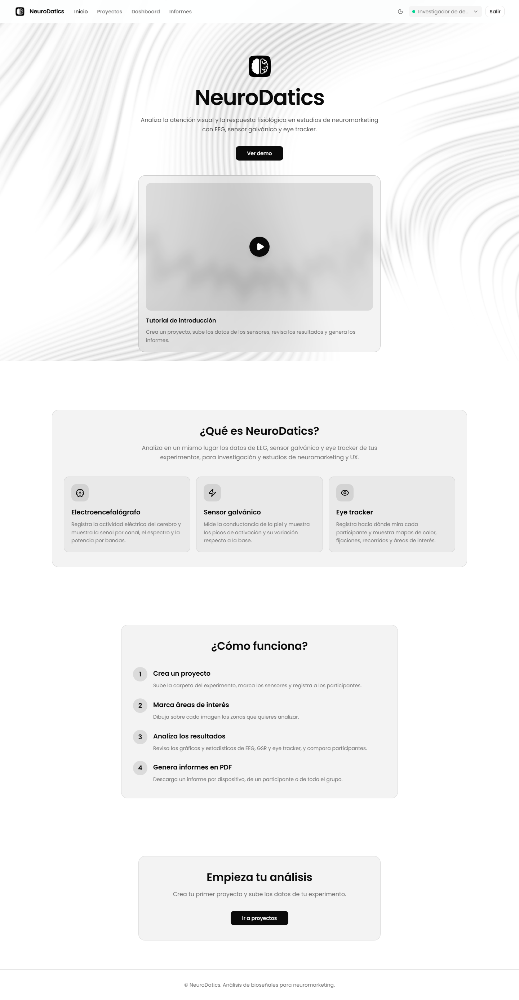

> Este manual fue revisado contra el frontend, el backend y los flujos actuales del repositorio. Las capturas se tomaron con Playwright sobre la interfaz de la plataforma, usando un proyecto de demostración con datos sintéticos. No contienen datos personales ni representan resultados científicos.

## 1. Qué hace NeuroDatics

NeuroDatics organiza proyectos de neuromarketing y permite consultar datos de Eye Tracker, EEG y GSR. El trabajo suele empezar en Proyectos, continúa con la revisión de la ingesta y termina en Dashboard o Reportes, según necesite explorar señales o compartir resultados.

**Acceder -> crear proyecto -> cargar carpeta -> confirmar sensores y participantes -> definir AOIs -> analizar -> comparar -> exportar.**

La aplicación ayuda a preparar y visualizar datos; no reemplaza el diseño experimental, el control de calidad ni la interpretación científica.

## 2. Ediciones disponibles

La interfaz es la misma, pero el acceso y el almacenamiento cambian según la edición.

| Edición | Acceso | Almacenamiento | Uso previsto |
| --- | --- | --- | --- |
| Servidor | Inicio de sesión con Google | Google Drive conectado a la instalación | Trabajo compartido dentro de una base de datos institucional |
| Local / estudiantes | Sin inicio de sesión manual. La aplicación crea una única sesión local | Carpeta local del equipo | Prácticas, análisis sin red y trabajo individual |

En la edición local no aparecen Google, Google Drive ni el botón **Salir**. El usuario que muestra la cabecera es **Estudiante**. Todos los proyectos de esa instalación pertenecen al mismo espacio local.

## 3. Roles y permisos reales

La versión actual no tiene roles de aplicación como administrador, editor, lector o supervisor. Tampoco tiene invitaciones ni permisos por proyecto.

| Persona o contexto | Puede hacer | No puede hacer |
| --- | --- | --- |
| Visitante sin sesión | Ver Inicio y abrir el acceso | Entrar a Proyectos, Dashboard, Reportes o Configuración |
| Usuario autenticado en servidor | Crear y administrar sus proyectos; cargar archivos; configurar sensores, participantes, escenarios y AOIs; analizar y exportar | Ver o modificar proyectos propiedad de otra cuenta |
| Usuario de edición local | Usar todos los módulos disponibles en su instalación y trabajar con sus archivos locales | Compartir la instalación como si tuviera cuentas separadas |
| Administrador técnico de la instalación | Configurar Docker, variables, OAuth, Google Drive, base de datos, puertos y respaldos | No obtiene un rol adicional dentro de la interfaz de NeuroDatics |

La protección de los datos se basa en la propiedad del proyecto. En servidor, las consultas y mutaciones se resuelven con el usuario autenticado y el propietario del proyecto. La conexión de Google Drive, en cambio, es compartida por todos los usuarios de la misma base de datos: cambiarla puede afectar el acceso de toda la instalación.

## 4. Módulos de la plataforma

### Inicio

Presenta la finalidad de la plataforma y el acceso a los módulos protegidos.

### Proyectos

Es el punto de entrada para crear, cargar, editar, revisar, archivar y eliminar proyectos. Los filtros separan el trabajo pendiente del que ya está activo y del que se conserva como histórico. Un borrador puede seguir en procesamiento; por eso conviene leer el estado de la ingesta antes de abrir Dashboard.

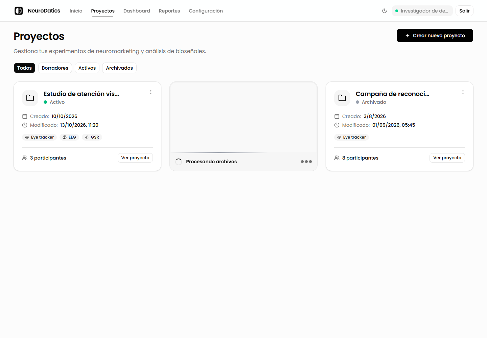

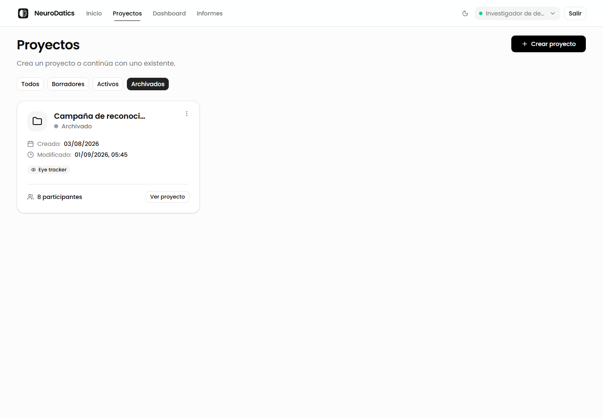

### Dashboard

Es el espacio de análisis. Incluye filtros de escenario y participante, un selector de sensor y vistas específicas para cada señal. El panel lateral mantiene visibles los proyectos y sus sensores, de modo que cambiar de Eye Tracker a EEG o GSR no exige abandonar el contexto del proyecto.

### Reportes

Genera un PDF por dispositivo o varios PDF dentro de un ZIP cuando se eligen todos los dispositivos.

### Configuración

Contiene el pre-experimento, la información de pantalla y los cuestionarios. En servidor también contiene el estado de la sesión y la conexión compartida de Google Drive.

## 5. Primer acceso

### Edición servidor

1. Abra la dirección entregada por el administrador.
2. Entre en **Iniciar sesión**.
3. Pulse **Continuar con Google**.
4. Elija la cuenta autorizada por la institución o el equipo de investigación.
5. Vuelva a NeuroDatics cuando termine la autorización.
El inicio de sesión no da acceso a la cuenta de Google Drive donde se guardan los archivos: esa cuenta la define la administración de la instalación.

### Edición local / estudiantes

1. Inicie la aplicación local.
2. Abra la dirección local indicada por el paquete, normalmente `http://127.0.0.1:8765`.
3. La sesión se crea automáticamente.
4. Entre en **Proyectos**.

No se necesita cuenta de Google ni conexión a Internet para el uso normal de esta edición.

### Cómo se documentó la autenticación

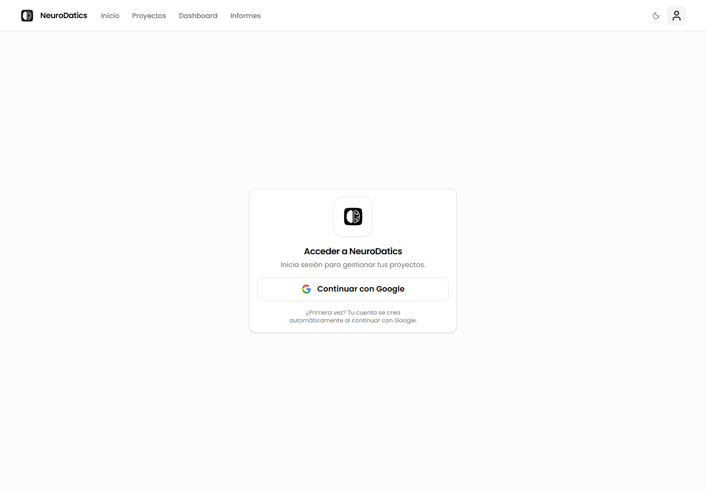

La edición servidor ofrece Google como único acceso. Al pulsar **Continuar con Google**, la aplicación solicita una URL de autorización, recibe el retorno de Google y canjea el código por una sesión propia de NeuroDatics. Esa sesión queda disponible para las consultas de proyectos y para las operaciones que requieren propiedad del proyecto. El permiso de Google Drive se concede después y se administra por separado.

Para tomar estas capturas, Playwright no abrió una cuenta de Google ni utilizó credenciales personales. Inició el frontend con una sesión sintética de demostración, con un usuario y un token efímeros, y respondió las consultas de la API con datos controlados. La pantalla, la navegación y los componentes que aparecen son los de la plataforma; los datos de señales, participantes y Drive son de prueba. La captura de **Iniciar sesión** muestra el acceso sin sesión, mientras que las vistas protegidas muestran el estado que tendría un investigador después de autenticarse.

## 6. Crear un proyecto con carpeta

En **Proyectos**, pulse **Crear nuevo proyecto** y elija **Con carpeta**.

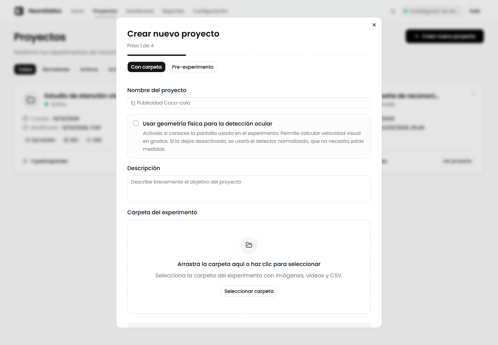

### Paso 1 de 4 - Información y carpeta

1. Escriba un nombre reconocible.
2. Añada una descripción si el proyecto necesita contexto.
3. Seleccione la carpeta completa del experimento.
4. Responda las preguntas de estructura cuando la aplicación detecte más de un CSV, varias carpetas de imágenes o videos, o una adquisición ambigua.
5. Si conoce la pantalla usada en la adquisición, active la geometría de pantalla y complete ancho, alto, tamaño físico y distancia ojo-pantalla.
6. Revise la colocación del estímulo en pantalla cuando la interfaz la solicite. Esta información permite interpretar coordenadas y visualizaciones espaciales.
7. Pulse **Siguiente**.

La carga valida la carpeta y muestra el resumen de archivos detectados. El límite de la configuración actual es de 500 MB para el archivo comprimido de proyecto. No cierre la pestaña durante una carga.

### Paso 2 de 4 - Sensores

Seleccione los sensores utilizados en el experimento:

- **Eye Tracker:** mirada, fijaciones, pupila, distancia, mapa de calor, mapa de recorridos y AOIs.
- **EEG:** señal por canal, densidad espectral, espectrograma y topografía.
- **GSR:** conductancia de la piel y estadísticas de la señal.

Cuando la carpeta lo permite, NeuroDatics muestra sensores detectados automáticamente. Revise la selección antes de continuar.

### Paso 3 de 4 - Participantes

La aplicación muestra los participantes detectados en los archivos. Para cada uno:

1. Abra su tarjeta si está contraída.
2. Complete sexo y edad cuando se soliciten.
3. Compruebe que el código corresponda al experimento.
4. Pulse **Siguiente** cuando todos estén completos.

No use nombres identificables si el protocolo permite trabajar con códigos.

### Paso 4 de 4 - AOIs

Para cada escenario de imagen:

1. Abra la imagen.
2. Dibuje un rectángulo o polígono sobre la zona relevante.
3. Asigne un nombre breve y estable, por ejemplo `Logo`, `Precio` o `Botón compra`.
4. Ajuste la forma y la posición.
5. Repita para cada zona que vaya a analizar.

Los escenarios de video no usan este editor de AOIs en este paso.

Pulse **Guardar proyecto**. La aplicación guarda sensores, participantes, escenarios y AOIs y deja disponible la ingesta para análisis.

## 7. Estados del proyecto y de la ingesta

El estado visible del proyecto y el estado de la ingesta no significan lo mismo.

### Estado del proyecto

- **Borrador:** todavía falta completar el flujo o la carpeta.
- **Activo:** proyecto disponible para trabajar.
- **Archivado:** proyecto conservado, pero fuera de la vista operativa principal.

### Estado de la ingesta

- `PENDING`: la carga todavía no termina o quedó pendiente.
- `PROCESSING`: los archivos se están validando y procesando.
- `READY`: los datos se publicaron y pueden consultarse.
- `FAILED`: el intento terminó con errores.

Si el proyecto está activo pero la ingesta no está en `READY`, el Dashboard puede aparecer vacío o incompleto.

## 8. Revisar un proyecto

En una tarjeta de proyecto puede:

- Pulsar **Ver proyecto** para revisar metadatos, participantes, escenarios y archivos.
- Abrir **Opciones del proyecto** para editar, archivar o eliminar.
- Usar **Continuar** o **Retomar** en un borrador incompleto.

Archivar no elimina los datos. Eliminar sí inicia una operación destructiva y debe confirmarse escribiendo `eliminar`. En edición local, la confirmación indica que también se eliminan los archivos guardados en el equipo.

## 9. Analizar en Dashboard

Abra **Dashboard** y seleccione un proyecto en el panel lateral. El primer sensor disponible se selecciona automáticamente.

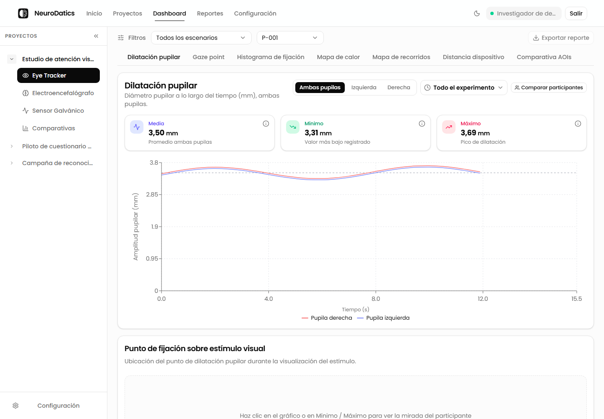

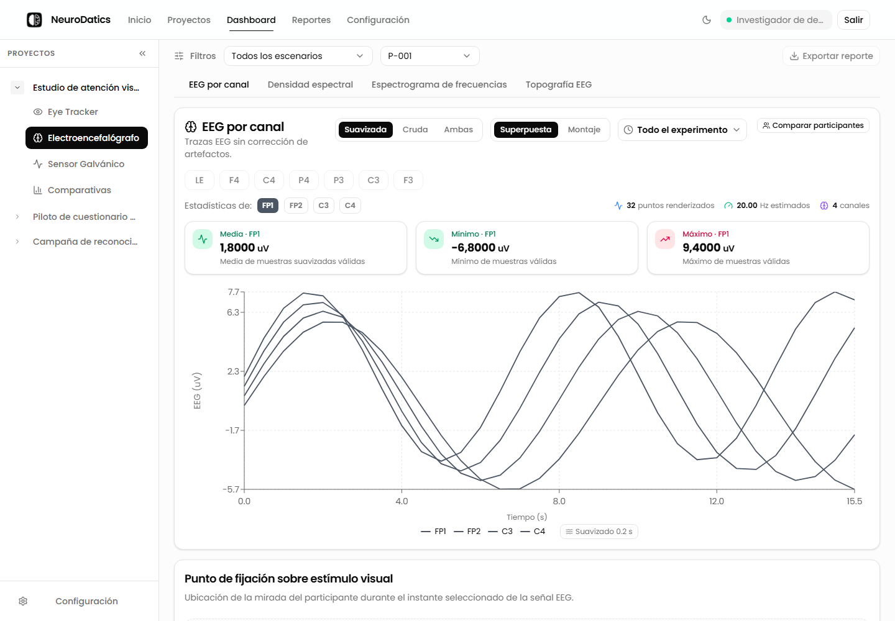

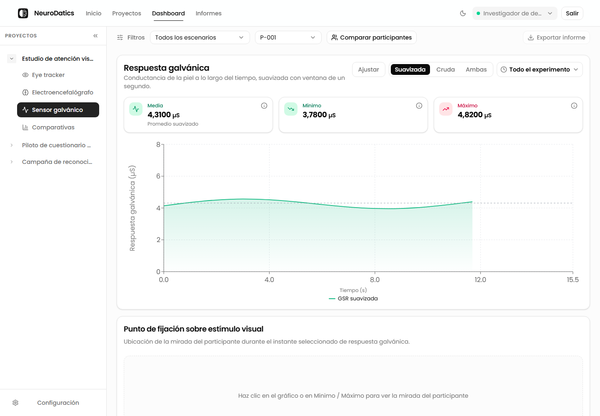

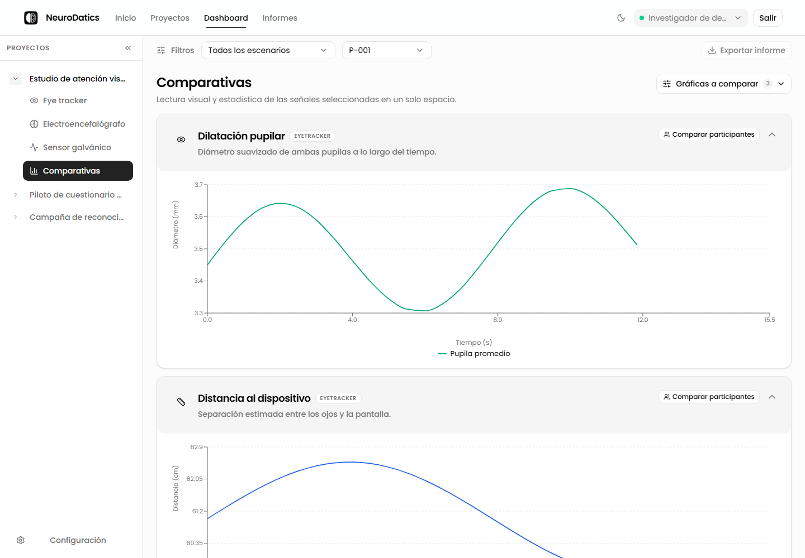

### Filtros comunes

El filtro **Escenario** permite trabajar con todos los escenarios o con uno específico. **Participante** cambia el código activo y **Comparar participantes** abre una comparación con los códigos disponibles del proyecto. El botón **Exportar reporte** conserva el proyecto seleccionado y lleva al flujo de Reportes.

### Eye Tracker

Las vistas disponibles son:

1. **Dilatación pupilar:** diámetro a lo largo del tiempo y estadísticas de promedio, mínimo y máximo.
2. **Gaze point:** coordenadas de mirada.
3. **Histograma de fijación:** distribución de duraciones.
4. **Mapa de calor:** densidad espacial sobre el estímulo.
5. **Mapa de recorridos:** secuencia de fijaciones.
6. **Distancia dispositivo:** distancia registrada durante la grabación.
7. **Comparativa AOIs:** fijaciones, tiempo de permanencia, TTFF, transiciones y métricas de las áreas.

Las vistas derivadas de fijaciones muestran un control de duración mínima. Mantenga el mismo valor cuando compare resultados.

### EEG

Las vistas disponibles son:

1. **EEG por canal:** señal temporal y estadísticas.
2. **Densidad espectral:** potencia por frecuencia y por banda.
3. **Espectrograma de frecuencias:** potencia en el tiempo y la frecuencia.
4. **Topografía EEG:** distribución esquemática entre electrodos.

Lea primero las advertencias de calidad. Una advertencia describe el archivo y sus limitaciones; no corrige automáticamente la señal ni convierte datos faltantes en ceros.

### GSR

La vista muestra la señal cruda y suavizada, la línea de base, los valores mínimo y máximo y las estadísticas disponibles. Interprete los picos junto con el protocolo experimental y el estado de la adquisición.

### Comparativas

La comparativa reúne visualizaciones seleccionadas y métricas calculadas sobre las mismas señales. Se puede dejar la selección por defecto o abrir **Gráficas a comparar** para añadir o quitar paneles. Todas las vistas comparten el participante y el escenario elegidos en Dashboard, así que conviene fijar esos filtros antes de leer los gráficos.

Use el mismo proyecto, señal y escenario, conserve el mismo umbral de fijación y compruebe si las escalas son comunes o propias. Una diferencia visual no es por sí sola una diferencia científica: revise las unidades, la cobertura y las advertencias de calidad.

Con **Todos los escenarios**, algunas vistas espaciales no tienen un instante común y solicitan un escenario específico.

## 10. Pre-experimento y cuestionarios

Desde **Configuración** se puede preparar un pre-experimento dentro del proyecto:

1. Registre participantes, códigos y datos de planificación.
2. Complete, si aplica, la geometría de la pantalla.
3. Añada notas del protocolo.
4. Active el cuestionario **Antes del experimento** o **Después del experimento**.
5. Añada preguntas de selección múltiple, texto abierto o verdadero/falso.
6. Guarde la configuración antes de responder.
7. Seleccione participante y fase para abrir **Responder cuestionario**.

La versión actual usa la sesión del investigador. No crea cuentas de participantes ni enlaces públicos.

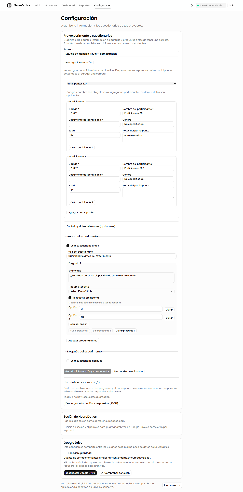

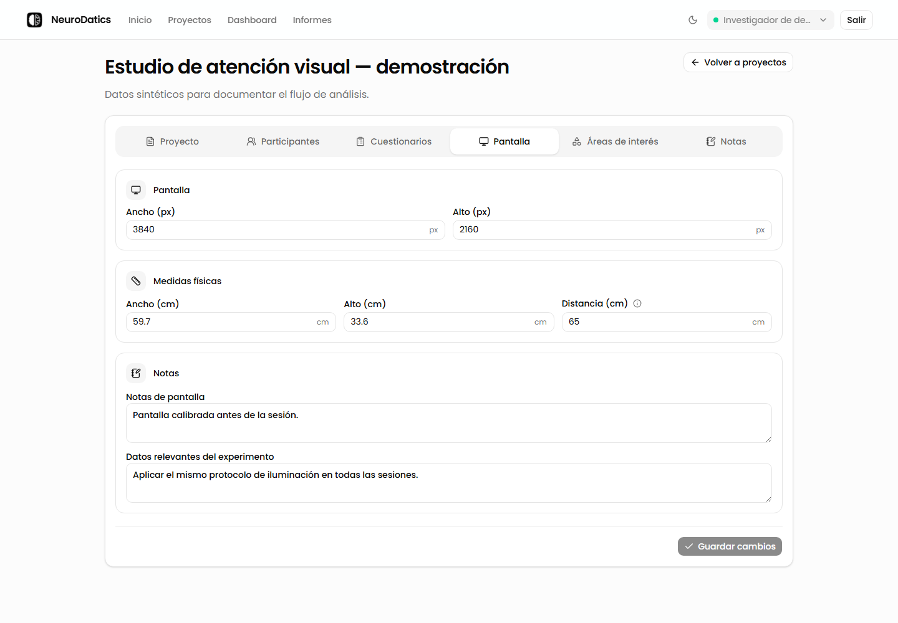

## 11. Google Drive en servidor

En la edición servidor los archivos de todos los usuarios se guardan en una sola cuenta de Google Drive. Esa cuenta la definen los administradores desde el equipo donde corre NeuroDatics; la aplicación no la muestra ni permite cambiarla.

Si al cargar un experimento aparece un aviso sobre Google Drive, avise a quien administra NeuroDatics. La administración conecta o renueva la cuenta con `_internal\scripts\conectar-drive.ps1` (ver anexo A) y debe usar la misma cuenta para conservar el acceso a los archivos existentes.

En edición local no se usa Drive: los archivos se conservan en el equipo.

## 12. Generar reportes

Abra **Reportes**.

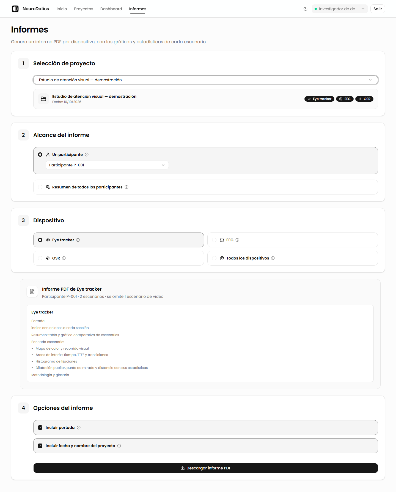

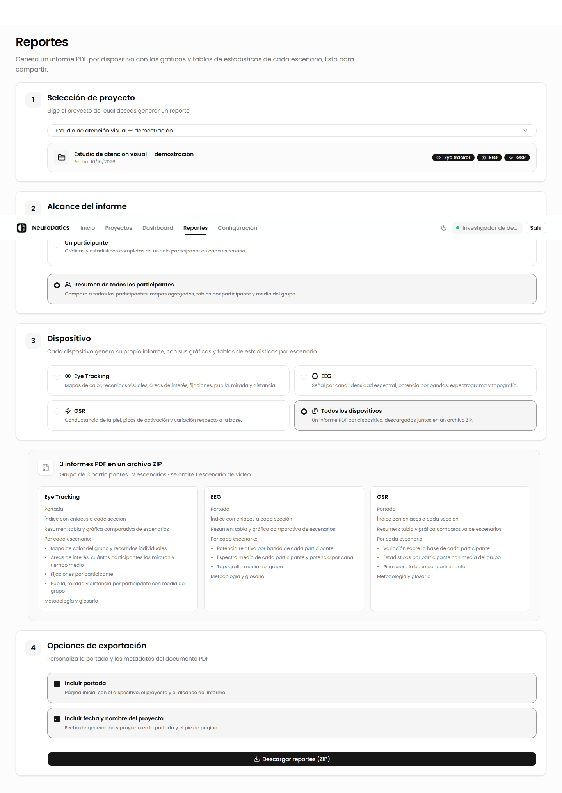

1. Seleccione un proyecto.
2. Elija el alcance:
   - **Un participante**, para las gráficas y estadísticas completas de un código.
   - **Resumen de todos los participantes**, para agregados, tablas por participante y media del grupo.
3. Elija el dispositivo:
   - Eye Tracking
   - EEG
   - GSR
   - Todos los dispositivos, si el proyecto tiene más de uno
4. Active o desactive portada y metadatos según el uso del informe.
5. Revise la vista previa.
6. Pulse **Descargar reporte PDF** o **Descargar reportes (ZIP)**.

El reporte se organiza por dispositivo e incluye resumen, estadísticas y secciones por escenario. Si eliges todos los dispositivos, la plataforma prepara un PDF por sensor y los descarga juntos en un ZIP. Los escenarios de video se omiten del reporte ejecutivo actual; la vista previa informa cuántos escenarios quedan fuera.

## 13. Problemas frecuentes

| Problema | Qué revisar primero |
| --- | --- |
| No puedo acceder a un módulo | Inicie sesión en servidor. En local, compruebe que el paquete esté iniciado. |
| No veo mis proyectos | Confirme que está usando la cuenta propietaria o la misma instalación local. |
| La carpeta no se puede cargar | Seleccione la carpeta completa, revise el límite de 500 MB y resuelva las preguntas de estructura. |
| El proyecto está vacío en Dashboard | Espere `READY`; revise proyecto, sensor, participante y escenario. |
| Falta un estímulo | Compruebe que la imagen o video exista en la carpeta y que el escenario tenga el archivo asociado. |
| EEG muestra advertencias | Revise calidad, canales incompletos y artefactos antes de interpretar. |
| No se habilita un reporte | Debe existir un participante, al menos un escenario de imagen y un dispositivo seleccionado. |
| Google Drive no conecta | Avise a la administración: comprueba la configuración OAuth y reconecta la cuenta autorizada desde el servidor. |
| El procesamiento termina en `FAILED` | Lea el resumen y las advertencias; corrija los archivos y vuelva a intentar. |

No comparta contraseñas, tokens, archivos `.env`, credenciales de Google ni datos identificables de participantes al pedir soporte.

## 14. Antes de analizar o exportar

- Conserve una copia de los datos originales.
- Use códigos consistentes para participantes y escenarios.
- Confirme sensores y columnas compatibles antes de interpretar.
- Espere a `READY`.
- Compruebe la geometría de pantalla si va a interpretar coordenadas.
- Nombre las AOIs según la hipótesis o la estructura del estímulo.
- Use filtros consistentes en comparativas.
- Revise unidades, escalas y advertencias.
- No interprete `Sin datos` como cero.
- Proteja los PDF y ZIP exportados según el protocolo de la investigación.

## 15. Glosario breve

| Término | Significado |
| --- | --- |
| AOI | Área de interés dibujada sobre un estímulo. |
| Baseline | Valor de referencia usado para interpretar cambios. |
| EEG | Registro de actividad eléctrica cerebral. |
| Eye Tracker | Sensor que registra mirada y fijaciones. |
| Fijación | Periodo en que la mirada permanece agrupada alrededor de una posición. |
| Gaze point | Coordenada de mirada en un instante. |
| GSR | Respuesta galvánica o conductancia de la piel. |
| Ingesta | Validación, procesamiento y publicación de archivos. |
| PSD | Densidad espectral de potencia. |
| Escenario | Imagen o video presentado durante una grabación. |
| TTFF | Tiempo hasta la primera fijación sobre una AOI. |

## 16. Soporte

Incluya en la solicitud:

1. Edición utilizada: servidor o local.
2. Sistema operativo y navegador.
3. Ruta del módulo donde ocurrió el problema.
4. Nombre del proyecto sin datos sensibles.
5. Mensaje exacto de la interfaz.
6. Estado del proyecto y de la ingesta.
7. Paso realizado antes del error.
8. Captura de pantalla con credenciales y datos personales ocultos.

Para problemas de Docker, OAuth, Google Drive, puertos, volúmenes o respaldos, contacte al administrador técnico. Para estructura de experimentos, sensores, participantes o interpretación, contacte al equipo de investigación responsable.

## Anexo A. Puesta en marcha para administración técnica

Este anexo no es necesario para el uso diario.

### Servidor

La entrega de Windows usa Docker Desktop y expone la interfaz en el puerto 3000. La API, PostgreSQL y Redis permanecen dentro de la red de Docker. El paquete no requiere instalar Node.js, Python, PostgreSQL ni Redis por separado.

Procedimiento resumido:

1. Extraiga el paquete completo fuera del ZIP.
2. Ejecute `INSTALAR.bat` la primera vez.
3. Autorice WSL o reinicie Windows si el instalador lo solicita.
4. Inicie el grupo `neurodatics` desde Docker Desktop o use `INICIAR.bat`.
5. Abra `http://localhost:3000`.
6. Configure OAuth según la entrega institucional y conecte la cuenta de Google Drive con `_internal\scripts\conectar-drive.ps1`.

No elimine volúmenes para resolver un error sin respaldo previo. Antes de actualizar, conserve los datos y el archivo `.env`.

### Local / estudiantes

La edición local usa un único usuario fijo y guarda archivos bajo el directorio local configurado. No depende de Google ni de la red para analizar los datos ya cargados. El paquete de estudiantes debe probarse con su lanzador y su `STUDENT_BASE_URL`; no se debe mezclar su directorio de datos con otra instalación.

## Fuentes de esta revisión

- `docs/manual_usuario_neurodatics.md` como línea base editorial.
- Frontend actual: rutas de Inicio, Proyectos, Dashboard, Reportes y Configuración.
- Backend actual: autenticación, propiedad de proyectos, ingesta, analítica, reportes y Google Drive.
- Capturas generadas con Playwright el 14 de octubre de 2026 sobre la interfaz de la plataforma y datos sintéticos.
